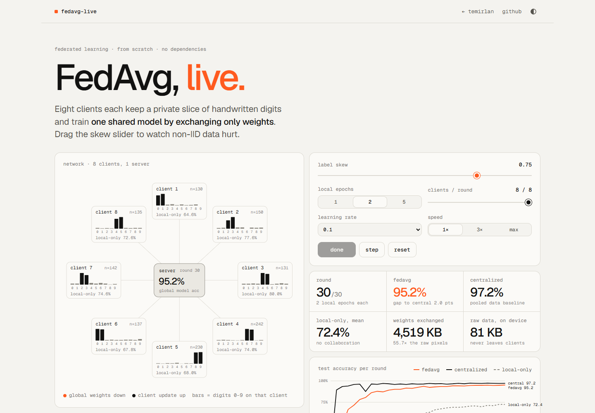

# FedAvg, live — federated learning playground

Eight clients each keep a private slice of handwritten digits and train one shared model by exchanging only weights (Federated Averaging). A slider adds label skew so you can watch non-IID data hurt.

**Live demo: https://temirlanzzz.github.io/fedavg-live/**



## How it works

Everything runs in one browser tab. Static HTML, CSS, JS and SVG; no dependencies, no build step.

- **Data.** UCI optical digits (scikit-learn `load_digits`, 8×8, values 0–16). 1,297 training images are split across 8 clients; 500 (50 per class) are held out for testing. Exported once by `tools/export_digits.py` into `data/digits.json` (124 KB).
- **Partition.** Client *k* "owns" digits `2k mod 10` and `2k+1 mod 10`. With probability *skew* an image goes to an owner of its digit, otherwise to a random client. Skew 0 is IID; skew 1 means every client holds exactly two digits.
- **Model.** A 64→32→10 MLP (ReLU, softmax cross-entropy), forward/backward pass and mini-batch SGD (batch 16) written by hand in `js/fl.js`. 2,410 parameters, 9,640 bytes as float32.
- **Round.** The server sends the global weights to the sampled clients; each trains for *E* local epochs on its own data and sends the weights back; the server sets the global model to the **sample-count-weighted mean** of the returned weights.
- **Baselines.** In lockstep, from the same initial weights: a centralized model trained *E* epochs per round on the pooled data, and eight local-only models trained *E* epochs per round on their own slice. Reported local-only accuracy is the mean of the eight on the full test set.
- **Bytes.** Each participating client downloads and uploads one full model per round: `clients × 2 × 9,640 B`.

## Results

`bench()` — 30 rounds, 2 local epochs, 8/8 clients per round, lr 0.1, batch 16, mean over seeds 1–3. Run in headless Chrome 155 on Windows (`index.html?bench`); raw output in [`docs/bench-chrome.json`](docs/bench-chrome.json). Test accuracy on the 500 held-out digits after round 30:

| label skew | FedAvg | centralized | local-only (mean) |
|---|---:|---:|---:|
| 0.0 (IID) | **96.7%** (96.0–97.6) | 97.3% (97.2–97.4) | 91.4% |
| 1.0 (2 digits per client) | **86.1%** (84.4–87.0) | 97.3% (97.2–97.4) | 19.9% |

Communication over 30 rounds: **4,519 KB** of weights exchanged vs **81 KB** of raw pixels that stay on the devices — **55.7×**.

Extra runs with the same code (node, seeds 1–3, full skew unless noted):

| setting | FedAvg |
|---|---:|
| 1 local epoch | 86.5% |
| 5 local epochs | 85.1% |
| 2 of 8 clients per round, IID | 95.8% |
| 2 of 8 clients per round, skew 1 | 63.4% |
| skew 0.5 | 95.9% |

### What I learned

- **FL protects privacy, not bandwidth.** The weights exchanged were ~56× the size of the data they protect. On a small dataset with a full model sent every round, moving the data would be far cheaper.
- **Non-IID is the real story.** IID FedAvg is within 0.6 points of centralized and crosses 90% by round 7. At full skew it ends 11 points lower and (seed 1) never reaches 90% in 30 rounds. Local-only models cap at ~20% because each has seen only 2 of 10 digits.
- **Skew and partial participation compound.** 2 of 8 clients per round costs ~1 point on IID data but ~23 points at full skew.
- **More local epochs did not help under skew** (5 epochs: 85.1% vs 1 epoch: 86.5%) — clients drift toward their own digits before averaging.

## Run locally

```sh
git clone https://github.com/temirlanzzz/fedavg-live
cd fedavg-live
python -m http.server 8000      # any static server; fetch() needs http, not file://
# open http://localhost:8000
```

Re-run the benchmark: open `http://localhost:8000/?bench` (result is logged to the console), click **run bench() in this tab** on the page, or call `await bench({ skews: [0, 0.5, 1] })` in DevTools. The core also runs under node:

```js
const FL = require('./js/fl.js');
const data = FL.prepare(require('./data/digits.json'));
console.log(FL.bench(data, { skews: [0, 1], seeds: [1, 2, 3] }).rows);
```

Re-export the dataset: `pip install scikit-learn && python tools/export_digits.py`.

## Structure

```
index.html              page: demo + write-up
css/style.css           design tokens (light/dark), layout
js/fl.js                MLP, backprop, SGD, partitioning, FedAvg sim, bench() — no DOM
js/app.js               SVG network + packet animation, controls, live chart, bench hooks
data/digits.json        1,297 train / 500 test digits, 64 chars per image
tools/export_digits.py  exports load_digits to data/digits.json
docs/                   screenshot, raw bench output
```

## Limits

- Single-tab simulation: no real network, stragglers, dropouts or asynchrony.
- No secure aggregation and no differential privacy — the server sees every raw update, and updates can leak training data.
- Tiny model and an easy dataset; real non-IID gaps are usually larger.
- Plain FedAvg only (no FedProx, SCAFFOLD, server momentum).
- Three seeds — enough to see the effect, not for tight error bars.

## License

MIT — see [LICENSE](LICENSE).
